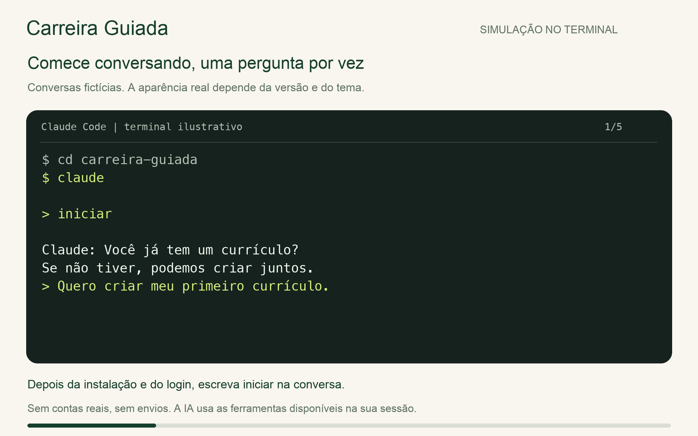
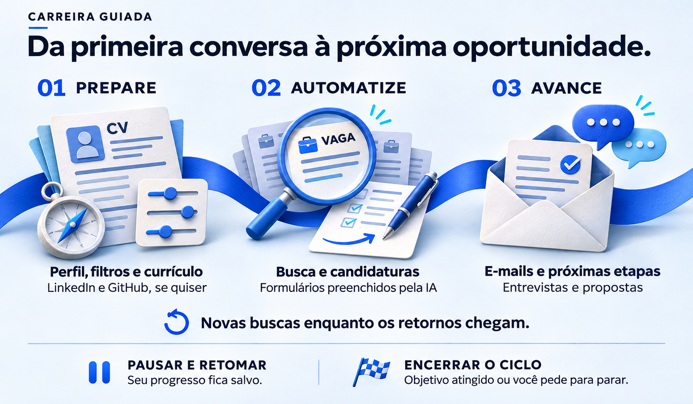
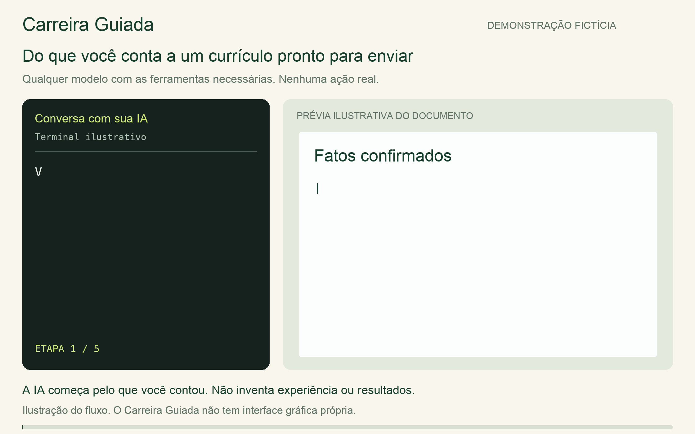
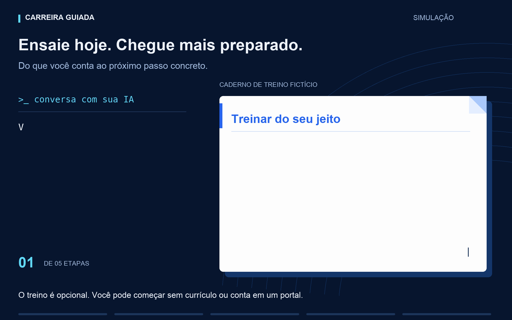
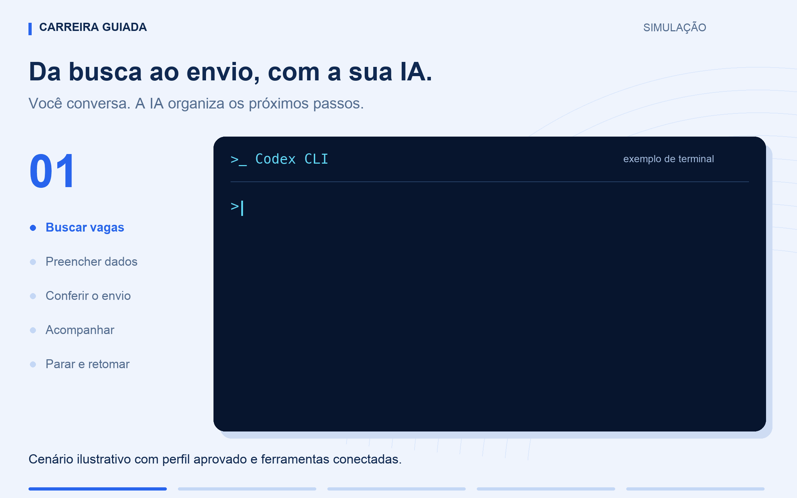
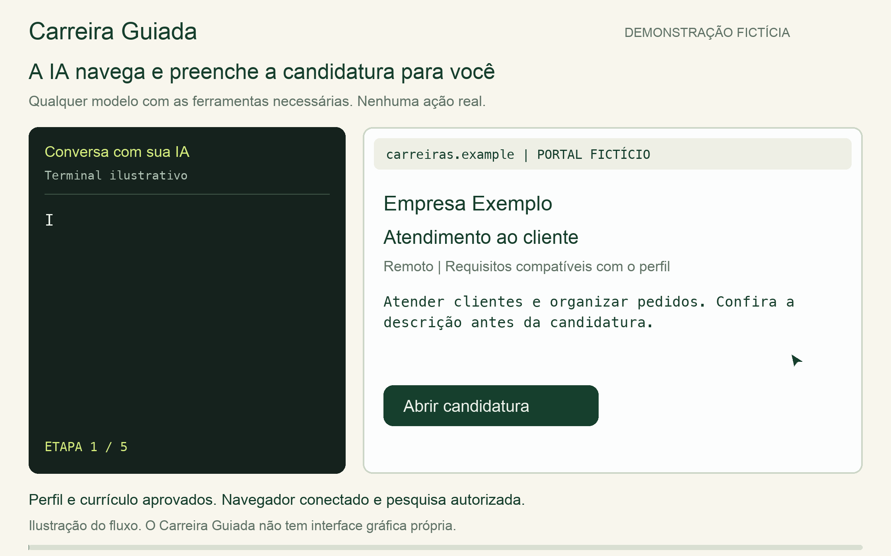

# Carreira Guiada

Automatize a busca de emprego e as candidaturas com sua IA. Ela encontra vagas
compatíveis, preenche os formulários com seus dados confirmados, envia o currículo
aprovado e acompanha os retornos por e-mail, dentro das permissões que você definir.

Você deixa de repetir os mesmos dados em cada portal e ganha tempo para se
preparar para as entrevistas. A IA também ajuda com currículo para ATS,
LinkedIn e GitHub, treinos com feedback e comparação de propostas.
Durante a campanha, informa o andamento e salva o progresso para retomar depois.

Use o modelo de sua escolha em uma ferramenta de IA com acesso a arquivos,
comandos locais e às integrações necessárias. O projeto é independente de
fornecedor de LLM. Claude Code e Codex CLI são exemplos de ferramentas, não
requisitos. A conversa acontece no aplicativo escolhido; o Carreira Guiada
não tem uma interface gráfica própria.

[Começar](docs/GUIA.md) · [Privacidade](docs/PRIVACIDADE.md) ·
[Dúvidas comuns](docs/FAQ.md) · [Última versão](https://github.com/everton-dgn/carreira-guiada/releases/latest) ·
[Contribuir](CONTRIBUTING.md) · [Licença MIT](LICENSE)

**Versão experimental.** As ações dependem das ferramentas do aplicativo,
das permissões que você deu e das regras de cada serviço. O Carreira Guiada não garante
contratação nem execução contínua quando a sessão da IA termina.

## Comece com "iniciar"

1. Baixe o projeto e abra a pasta `carreira-guiada` no seu aplicativo de IA.
   Ele precisa conseguir ler a pasta e executar ferramentas
   locais. [Veja o passo a passo](docs/GUIA.md#primeira-vez).
2. Escreva **iniciar** no chat.
3. A IA pergunta uma coisa por vez. Anexe seu currículo ou diga que quer
   criar um. Se não souber responder, diga "não sei".

Depois de abrir a ferramenta, você conversa em linguagem comum. A IA conduz
os comandos locais. O guia explica como abrir uma sessão no terminal; se
faltar uma ferramenta, o assistente orienta a instalação autorizada.

Você também pode começar por uma necessidade específica:

| Diga no chat | O que acontece |
|---|---|
| "Quero só ver vagas por enquanto" | A IA prepara filtros e fontes; o currículo pode ficar para depois. |
| "Não tenho currículo" | Ela monta um rascunho com você, sem inventar experiências. |
| "Quero treinar uma entrevista" | O treino começa sem exigir cadastro, currículo ou conta de e-mail. |
| "Continue de onde parei" | Ela confere o progresso salvo e segue pelas próximas ações autorizadas. |

*Exemplo no Claude Code. A aparência real depende da versão e do tema.*

## Uma jornada para chegar preparado

A ordem da imagem ajuda a entender o percurso. Durante a execução, a IA
intercala novas buscas com os retornos dos processos em andamento: você não
precisa esperar a resposta de uma empresa para buscar outra vaga.
Ela executa as ações permitidas pelo perfil aprovado; login, decisões pessoais
e testes que não permitem auxílio ficam com você. O fim de uma rodada dá início
à próxima. O ciclo encerra quando o objetivo combinado é atingido ou você pede
para parar, respeitando a duração da sessão e os limites que definiu.
LinkedIn, GitHub e treino de entrevistas são opcionais e podem acontecer antes
da busca. Comparação de propostas entra quando você quiser analisar uma oferta.

As demonstrações desta página usam dados fictícios. Os terminais e o portal ilustram
ferramentas externas; o projeto não instala essas telas. Nenhuma ação real é
executada nas demonstrações.

## Escolha o modelo por etapa

Para configurar o perfil e revisar o currículo, recomendamos começar com um
modelo mais capaz, como **GPT-6 Astra ou Claude Opus 5.5**. Depois, **GPT-6.1
Terra com esforço médio (`medium`)** é a sugestão do projeto para a operação;
use alto (`high`) nos formulários e decisões mais difíceis.

Essas são recomendações, sem bloquear outros modelos. A IA explica as opções
disponíveis na sua ferramenta e ajuda a começar com o que você já tem.
[Como escolher e trocar de modelo](docs/MODELOS.md).

## Trabalhe por objetivo

Depois do preparo, você pode dizer:

> Procure vagas compatíveis nas fontes que aprovei e envie as candidaturas
> permitidas pelo meu perfil. Continue pelas próximas vagas sem me perguntar
> a cada lote. Use o modo objetivo, se estiver disponível, e me chame quando
> precisar de uma decisão minha.

A IA confirma o alcance das permissões e usa o modo objetivo (`goal`) quando
o aplicativo oferece esse recurso. Com pesquisa, preenchimento e envio
autorizados, a rodada segue sem confirmação por vaga. Em "pergunte antes",
o envio continua dependendo da sua resposta.

O objetivo é sustentar campanhas longas, inclusive por dias em ambientes que
mantenham a execução ativa. Limites de uso, autenticação e ações exclusivas da
pessoa ainda podem exigir intervenção. Um bloqueio isolado fica pendente e
as outras vagas seguem. [Como funciona a continuidade](docs/GUIA.md#buscar-por-objetivo).

Se quiser acrescentar outra atividade depois, diga, por exemplo: "inclua o
acompanhamento dos e-mails nesta campanha". A IA amplia o objetivo com sua
confirmação, preserva o histórico e confere as permissões necessárias.

## Transforme sua experiência em um currículo claro

A IA organiza suas experiências, melhora a redação e prepara PDF, Word e texto
com fatos que você confirmou. A [revisão para ATS](docs/ATS.md) confere a leitura
dos arquivos e ajuda a apresentar as experiências relevantes para a vaga.
Você revisa e aprova cada versão antes do envio.

## Faça seu perfil contar a mesma história

Você pode pedir uma [revisão da sua apresentação profissional](docs/PRESENCA-PROFISSIONAL.md):
título, resumo e experiências do LinkedIn; para tecnologia, README do GitHub,
projetos em destaque e apresentação dos repositórios. A IA prepara os textos
e você decide o que publicar. O objetivo é deixar claro o que você faz,
quais problemas já resolveu e por que sua experiência importa para a vaga.

## Treine para conquistar a vaga

Escreva "quero treinar uma entrevista". Você pode praticar antes de se
candidatar ou colar a descrição de uma vaga para preparar aquela conversa.
A IA faz uma pergunta por vez, escuta sua resposta e ajuda a contar sua
trajetória com exemplos verdadeiros.

Escolha treino com ajuda a cada resposta ou simulado com devolutiva ao final.
Há preparação para RH, apresentação pessoal, perguntas comportamentais e,
na área de tecnologia, entrevista técnica, exercício de código e system design.
Você pode pedir uma dica, tentar novamente, parar e continuar em outro dia.
Respostas e feedback ficam privados e não são enviados a recrutadores.
O feedback aponta lacunas, sugere um exercício e compara suas tentativas.
Se seu aplicativo oferecer voz, experimente falar para tornar o treino mais
realista. Também há preparação internacional e negociação salarial.
[Conheça os treinos e exemplos](docs/ENTREVISTAS.md).

*Treino fictício em texto. Para ensaiar falando, use voz se seu aplicativo oferecer.*

## Você escolhe onde procurar

O projeto começa **sem lista de sites de vagas**. No onboarding, a IA pede
os links que você quer usar. Basta copiar o endereço da barra do navegador
e colar no chat. A escolha fica no seu perfil privado.

Não conhece nenhum site ainda? Peça ajuda para encontrar opções verificadas.
A IA pesquisa identidade, origem e sinais de risco antes de sugerir; você
escolhe os links. Pode também deixar a busca para depois. Cada vaga passa por
conferência própria, mesmo quando o site é conhecido.

## Entenda a empresa e compare propostas

Peça uma [análise da empresa](docs/EMPRESAS.md): reputação, relatos de
funcionários, condições da vaga e referências salariais com fonte e data.
A IA separa fatos, relatos e dúvidas, sem tratar popularidade como segurança.

Recebeu uma oferta? [Compare CLT, PJ, MEI, cooperado ou internacional](docs/PROPOSTAS.md)
com valores anuais, benefícios, custos, reservas e impostos informados.
Premissas ausentes ficam visíveis; a IA ajuda a negociar e você decide.
Para trabalhar fora ou para outro país, veja [a preparação internacional](docs/INTERNACIONAL.md).
[Como informar e alterar os links](docs/FONTES.md).

## Coloque a busca para trabalhar

A IA aplica seus filtros, avalia as oportunidades e segue pelas vagas
processáveis. Uma pendência em um portal fica registrada enquanto as outras
avançam. Os retornos por e-mail entram na mesma rotina, com prazos e próxima
ação ligados à candidatura certa.

*Exemplo no Codex CLI, com perfil aprovado e ferramentas conectadas.*

## Um formulário a menos para preencher à mão

Com navegador conectado, a IA abre a vaga, preenche os dados confirmados,
anexa o currículo aprovado e confere o resultado do envio autorizado.

*Neste exemplo, a pessoa escolheu "pergunte antes de enviar".*

## Você continua no controle

- A IA informa o andamento da busca, do preenchimento e dos retornos, e diz
  quando precisa de uma ação sua. O padrão é de duas abas de trabalho.
- O progresso fica salvo. Ao voltar com `iniciar`, escolha continuar ou revisar
  a preparação, sem refazer tudo. [Feedback, abas e retomada](docs/ACOMPANHAMENTO.md).
- Diga **parar** para interromper novas ações. Diga **continuar** para retomar
  o progresso salvo durante uma sessão ativa.
- Login, senha, códigos, entrevistas e respostas pessoais ficam com você.
  A IA não deve se passar por você em avaliações pessoais.
- Respostas de e-mail e agendamentos exigem aprovação específica. A limpeza
  de e-mails usa categorias autorizadas e somente a lixeira restaurável.
- Um envio com resultado incerto precisa ser conferido antes de outra tentativa.
- Um link fornecido por você ainda precisa ser verificado. Ele não comprova
  legitimidade da empresa nem autorização para automatizar o serviço.

Os registros ficam numa subpasta privada do projeto, no seu computador. O aplicativo de IA
também processa o conteúdo que recebe; o banco local não é criptografado.
[Leia o guia de privacidade](docs/PRIVACIDADE.md).

## O que é necessário

| Item | Como funciona |
|---|---|
| Aplicativo de IA | Conta e sessão próprias, com acesso à pasta e a ferramentas locais. O Carreira Guiada não inclui assinatura de IA. |
| Sistema | macOS ou Linux. Windows nativo não é suportado; uso via WSL ainda precisa de validação. |
| Controle local | Python 3.11 ou superior e `uv`. A IA ajuda a preparar o ambiente. |
| Sites e e-mail | Ferramentas disponíveis e sessões conferidas no aplicativo. O acompanhamento de e-mail atual aceita Gmail e Outlook. Sem conexão, essas etapas ficam pendentes. |

Os testes exercitam a CLI e um navegador com portal e e-mail fictícios locais.
Ainda não comprovam uma campanha real por
vários dias nem compatibilidade com todas as interfaces de recrutamento.
[O que foi e o que não foi validado](docs/VALIDACAO.md).

## Encontre o guia certo

| Quero... | Leia |
|---|---|
| Começar do zero | [Guia de início](docs/GUIA.md) |
| Atualizar sem perder progresso | [Atualização e cópia de segurança](docs/GUIA.md#atualizar-sem-perder-o-progresso) |
| Entender as perguntas | [Onboarding](docs/ONBOARDING.md) |
| Escolher modelo e esforço | [Modelos e ferramentas](docs/MODELOS.md) |
| Escolher os links de busca | [Fontes escolhidas por você](docs/FONTES.md) |
| Criar ou revisar um currículo | [Currículos](docs/CURRICULOS.md) |
| Entender permissões e dados | [Privacidade](docs/PRIVACIDADE.md) |
| Resolver uma dúvida | [Perguntas frequentes](docs/FAQ.md) |
| Melhorar o projeto | [Contribuição](CONTRIBUTING.md) e [arquitetura](docs/CONTRATOS.md) |
| Relatar uma vulnerabilidade | [Política de segurança](SECURITY.md) |

## Contribua

Relatos de problemas, melhorias no fluxo e testes são bem-vindos. Use sempre
dados fictícios em issues e pull requests. Não anexe currículos, caixas de
e-mail, perfis privados ou capturas com dados pessoais.

O [guia de contribuição](CONTRIBUTING.md) explica instalação, testes e a
checagem antes de publicar. A comunidade segue o [código de conduta](CODE_OF_CONDUCT.md).

## Licença

[MIT](LICENSE), sem cláusulas adicionais. Você pode usar, modificar e
distribuir, inclusive comercialmente, preservando os avisos exigidos pela
licença. O software é fornecido sem garantia. A licença do projeto não
substitui as regras dos serviços acessados.
