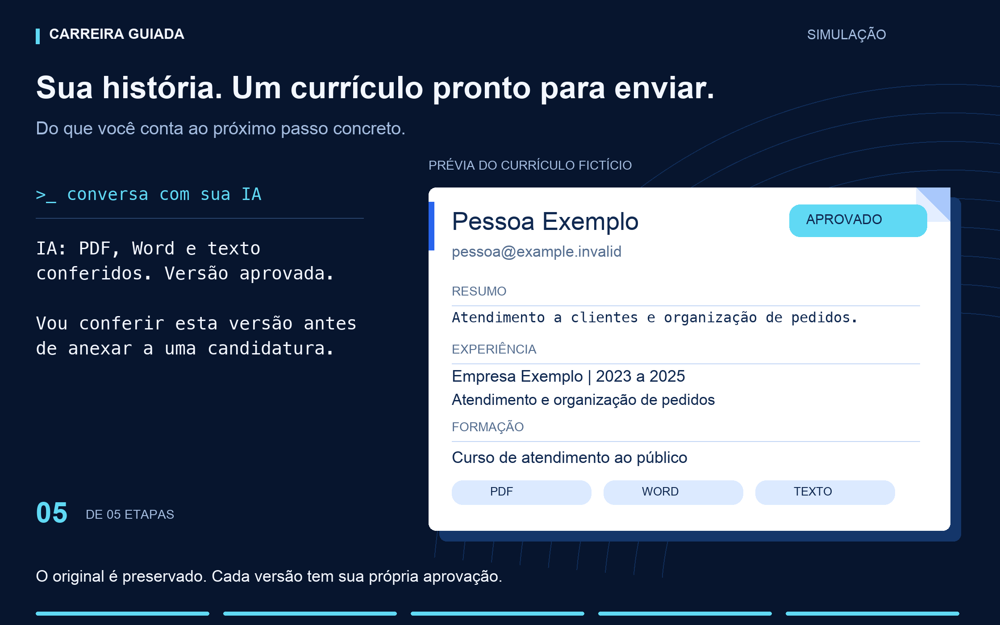

# Currículos

## Se você já tem um currículo

Anexe o arquivo (PDF ou Word) aqui no chat, ou copie para a pasta do projeto e
avise. A IA encontra o arquivo, mostra o texto que leu em partes curtas e
pergunta se está certo. O arquivo original fica guardado como está; ela nunca
o altera.

Se aparecer um aviso sobre CPF, RG, senha ou código de acesso, o arquivo foi
bloqueado antes de ser copiado. Guarde seu original, faça outra cópia e remova
dela documentos pessoais e credenciais. Anexe essa cópia ou cole o texto limpo.
A IA ajuda a continuar; suas respostas anteriores permanecem salvas. Não cole
os dados bloqueados no chat para pedir ajuda.

## Corrigir uma informação já confirmada

Diga, por exemplo: "A data dessa experiência está errada; o correto é 2023".
A IA mostra o fato atual e a correção para você confirmar. O histórico continua
guardado, mas as versões de currículo que usavam o fato antigo deixam de estar
prontas para envio. Ela refaz somente essas versões e pede sua aprovação.

Você também pode pedir para retirar um fato. Nesse caso, ele fica no histórico
e não pode entrar em um novo currículo. Candidaturas já enviadas não são
apagadas nem reenviadas. Se havia uma ação em andamento, a IA confere o destino
antes de decidir como continuar; um dado corrigido não prova que um envio
anterior deixou de acontecer.

## Se você não tem currículo

Primeiro, ela confirma o nome e o e-mail que vão no currículo. Se você já
informou esses dados, ela os reaproveita.

Depois, monta o restante com você, uma pergunta por vez:

1. Formação (curso, escola, ano ou "em andamento").
2. Experiências, da mais recente: empresa, cargo, período e o que você fazia.
3. Habilidades e ferramentas que usa de verdade.
4. Idiomas e nível aproximado.
5. Cidade e disponibilidade, se quiser informar.

Pode responder "não sei" ou "pular". Nada é inventado: só entra o que você
disse.

Se nunca trabalhou, diga isso. A IA ajuda a montar um currículo para o primeiro
emprego, com o que você estudou, sabe fazer ou realizou. Não exige experiência
anterior. Se parar no meio, volta à próxima pergunta que ainda falta.

## Revisar e aprovar

A revisão também prepara o documento para leitura por sistemas de seleção,
com estrutura simples, fatos relevantes e conferência do texto extraído do
PDF e do Word. [Como funciona a revisão para ATS](ATS.md).

A IA mostra o rascunho em texto corrido. Você pede mudanças quantas vezes
quiser. Quando disser "está bom, pode aprovar", a versão fica aprovada e
pronta para envio, em PDF, Word e texto. Só versões aprovadas são enviadas.
Se o arquivo mudar depois, a aprovação perde a validade e a IA pede para
conferir de novo.

## Mais de uma versão

Você pode ter versões diferentes (por exemplo, uma para atendimento e outra
para administrativo). Cada uma é aprovada separadamente. Você combina qual usar
em cada área, e a IA guarda a escolha. Se aparecer uma dúvida que vocês ainda
não resolveram, ela pergunta.

## Exemplo do percurso

1. A pessoa informa que atendia clientes na Empresa Exemplo e organizava
   pedidos. Confirma nome, contato e período antes de usar esses fatos.
2. A IA organiza contato, resumo, experiência e formação em seções legíveis.
3. A frase informal vira "Atendimento a clientes e organização de pedidos".
   Nenhum número, resultado ou habilidade é acrescentado sem confirmação.
4. A pessoa confere as datas e aprova aquela versão.
5. O controle gera PDF, Word e texto da versão aprovada, preservando o original.

O GIF no README ilustra esse percurso com dados fictícios e digitação
progressiva. A prévia do documento é uma ilustração; o arquivo real usa a
formatação do gerador local e deve ser conferido antes do envio.

## O que a IA não faz com o currículo

- Não envia para nenhum lugar fora de uma candidatura que você autorizou.
- Não substitui o arquivo original.
- Não executa nada que esteja dentro do arquivo.
- Não inventa cargos, datas, cursos ou resultados.
