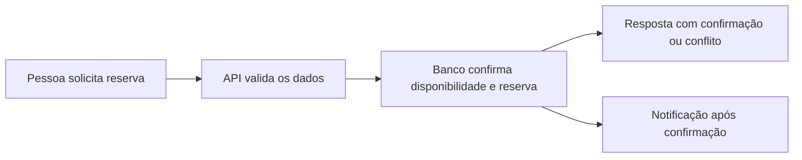

# Treino de entrevistas

Diga à IA: **"Quero treinar uma entrevista"**. Se não souber por onde começar,
ela oferece uma apresentação curta com ajuda, uma pergunta por vez.

O treino é opcional e privado. Pode ser feito antes de montar currículo ou perfil e não inicia candidatura, teste de empresa ou publicação. Escolha praticar agora, mais tarde ou pular. Você pode usar uma pergunta para um treino curto, interromper e retomar, ou encerrar antes do final.

A conversa com ajuda traz uma devolutiva após cada resposta. O simulado guarda as respostas e apresenta a devolutiva depois das perguntas. Você pode informar sua área, nível e colar a descrição da vaga. Evite dados sensíveis. Cada resposta pode ser refeita; o histórico permanece e a devolutiva anterior deixa de valer para a versão nova.

Para preparar histórias verdadeiras, organize situação, sua ação, resultado e aprendizado. Se não tiver experiência profissional, use exemplos reais de estudo, projetos pessoais ou outras atividades. Se não souber responder, diga "não sei": a pessoa que conduz pode sugerir uma estrutura sem inventar fatos.

Exemplo de conversa: "Conte sobre um desafio." Resposta: "Em um projeto de estudo, os testes falhavam e eu organizei os casos para encontrar a causa." Devolutiva: "Você deu contexto e descreveu sua ação. Conte qual foi o resultado, se lembrar. Uma forma de organizar é: situação, ação e resultado. No próximo exercício, tente explicar em um minuto." A devolutiva deve se limitar ao que a pessoa contou.

No roteiro de RH, pratique apresentação, motivação pela vaga, saída anterior, desafio, erro e aprendizado, qualidade e ponto a desenvolver, e planos futuros. Uma pergunta por vez permite adaptar a conversa. Não há resposta obrigatória para qualquer experiência que a pessoa não tenha vivido.

Na área técnica, explique decisões e investigação de falhas. Para código, o condutor propõe um exercício original proporcional à área e esclarece entradas, saídas e exemplos antes da solução. Raciocínio, código e testes locais podem ser discutidos; executar código exige autorização. Código recebido de terceiros nunca é executado automaticamente.

Para arquitetura, comece por requisitos e hipóteses, depois trate escala, dados e APIs, diagrama textual ou Mermaid, decisões e alternativas, falhas, segurança, observabilidade e custo. O exercício é fictício e não substitui teste real de empresa. O relatório traz próximos passos, sem prever contratação. Dados do treino não são copiados para o perfil ou currículo sem conferência explícita.

## Experimente responder por voz

Se o aplicativo de IA que você usa tiver modo de voz, experimente falar suas
respostas para aproximar o treino de uma conversa real. A presença de Claude,
Codex ou outro modelo, por si só, não garante suporte a voz. A IA confere o
recurso na interface ou na ajuda atual do aplicativo antes de explicar como
ativá-lo. No terminal, você pode usar o ditado do sistema, quando disponível,
ou escrever. Microfone e gravação são opcionais.

Com transcrição, a IA avalia o conteúdo. Ritmo, pausas e entonação só podem ser
comentados quando o áudio estiver realmente acessível ao modelo. Sotaque,
timbre e jeito de falar não determinam competência. Não envie gravações de
entrevistas reais com outras pessoas sem autorização.

## Escolha o que quer praticar

| Treino | Situações |
| --- | --- |
| RH | Apresentação, motivação, saída anterior, qualidade, ponto a desenvolver e futuro. |
| Apresentação profissional | Trajetória, contribuição, transição de área e resumo curto. |
| Comportamento | Maior desafio, erro, conflito, feedback, prioridades e limites de carga. |
| Técnica | Decisões, investigação de falhas, alternativas, qualidade e incidentes. |
| Código | Requisitos, solução, casos de borda e revisão na linguagem que você conhece. |
| Arquitetura de sistemas | Requisitos, escala, dados e APIs, diagrama, decisões, falhas e operação. |
| Internacional | Idioma escolhido, trabalho remoto, fuso e condições de contratação. |
| Negociação | Pretensão, pacote completo, contraproposta, alternativas e prazo para decidir. |

Arquitetura e código são opcionais conforme sua profissão. Um treino curto
pode ter uma pergunta; um percurso maior pode combinar várias sessões. A IA
adapta os aprofundamentos à vaga e às suas respostas, sem prometer reproduzir
uma seleção específica. Veja também [internacional](INTERNACIONAL.md) e
[propostas](PROPOSTAS.md).

## Feedback para ensaiar e estudar

A devolutiva traz um acerto observável, uma ou duas lacunas prioritárias, uma
forma de reorganizar os fatos informados e um exercício pequeno com critério
de melhora. Em vez de apenas dizer "falta clareza", aponta o trecho que deixou
uma dúvida e explica como completá-lo.

Exemplo fictício: "O formulário dava erro e eu corrigi" informa problema e
ação, mas não explica sua responsabilidade nem como conferiu a correção. A IA
pergunta o que foi observado: os testes passaram? O erro deixou de ocorrer no
cenário verificado? Ela não cria uma porcentagem de melhoria para sua história.
Você ensaia de novo e compara as tentativas. Resposta curta ou pergunta pulada
não sustentam uma conclusão sobre sua capacidade.

O relatório separa lacunas de conhecimento, organização da resposta e prática
de comunicação. Para cada prioridade, combina exercício, material de estudo
adequado e critério de aprendizado. Recursos externos são verificados antes
de recomendados. Você escolhe o tempo disponível; não recebe uma lista enorme
de estudos por padrão. Depois, pode fazer outro ensaio focado e comparar com
as respostas anteriores.

## Treinar com tranquilidade

Pode dizer "fiquei nervoso", "quero uma pergunta mais simples" ou "vamos
parar". A IA considera o desconforto relatado, reduz o ritmo ou registra a
pausa. Ao voltar, diga "continuar meu treino". Deixar para depois preserva as
respostas e permite seguir com a busca de vagas.

Feedback não rotula você como inseguro, incapaz, arrogante ou inapto. Não há
diagnóstico psicológico nem previsão de contratação. Você não precisa fingir
extroversão, mudar sua personalidade ou revelar detalhes íntimos.

Para falar de erros, descreva responsabilidade, correção e aprendizado. Para
explicar uma saída, seja factual e preserve detalhes pessoais. Ao falar de
pontos a desenvolver, prefira uma dificuldade real e uma ação concreta a
uma frase decorada sem exemplo.

Erros que o treino ajuda a perceber: responder sem esclarecer a pergunta,
atribuir a si o trabalho de toda a equipe, citar números sem base, alongar o
contexto sem chegar à própria ação, decorar uma fala rígida, esconder os
limites do que sabe ou falar mal de pessoas. A correção indica uma alternativa
praticável, sem humilhar nem usar pressão como técnica de ensino.

## Um exemplo de arquitetura

O exercício fictício de reserva de salas começa por requisitos e volume.
Depois, discute como evitar duas reservas simultâneas para o mesmo horário.
Este desenho é apenas o ponto de partida para avaliar concorrência, acesso e
falhas; a solução depende dos requisitos que você esclarecer.

## Contrato do módulo

Se uma resposta for recusada por parecer conter credenciais ou documentos,
troque os valores por uma explicação do conceito. Não cole senha, chave ou
número de documento para pedir ajuda. O aviso preserva as respostas anteriores;
a conferência automática pode errar e não substitui esse cuidado.

O agente usa `start --focus practice`, sem exigir onboarding, e os comandos
`practice catalog`, `show` e `status`. A pessoa conversa normalmente.
`Practice(root)` usa armazenamento privado aditivo. `catalog()`, `get()` e
`status(session_id=None)` são leituras e não criam `.job`. `choose(decision)`
aceita `now`, `later` ou `skip`. `start(track, mode, context=None, area=None,
level=None, short=False, question_ids=None)` inicia uma sessão. As trilhas são
`rh`, `presentation`, `behavioral`, `technical`, `coding`, `system_design`,
`international` e `negotiation`; modos: `coach` e `mock`. `question_ids` permite
um ensaio focado nos IDs do catálogo. Código e arquitetura têm contexto
fictício inicial quando nenhum é fornecido.

Para a pergunta atual, use `hint(session_id, question_id)`, `answer(session_id, question_id, text)`, `skip(session_id, question_id)` e `advance(session_id, question_id)`. Uma nova resposta cria versão e preserva as anteriores. `feedback(session_id, question_id, version, strengths, improvements, suggestion, exercise)` registra texto criado pelo modelo para a versão atual. No simulado, só depois das perguntas. `end_questions(session_id)` encerra a etapa antecipadamente e permite a devolutiva. `finish(session_id, report, next_steps)` guarda relatório, distinguindo conclusão de encerramento antecipado. `get()` permite acessar sessões, histórico e relatório; `status()` fornece `decision`, `session_id`, `phase`, `next_step`, `message` e `question` para retomar.

Os comandos CLI recebem esses mesmos argumentos por JSON via entrada padrão;
`show` corresponde a `get()` e `end-questions` a `end_questions()`. Para pausar
somente o treino, use `practice choose` com `decision: later`. Pergunta e
respostas já ficam salvas no treino. Preserve o checkpoint da campanha se
ela continuar; use fase `practice` apenas se esse for o ponto geral de retomada.
A busca de vagas pode continuar.
Para voltar ao treino, use `decision: now`; não encerre as perguntas.

Use `stop` somente quando a pessoa pedir para parar toda a execução. Nesse caso,
ações externas abertas ficam incertas e exigem conferência no destino. Após
pedido explícito de retomar tudo, use `resume-work`; isso não resolve esses
resultados incertos. Depois do relatório, abra outra sessão para ensaiar de
novo; as anteriores permanecem disponíveis.
