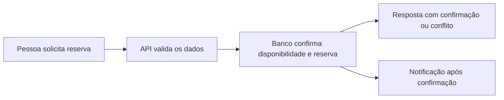

# Treino de entrevistas

Diga à IA: **"Quero treinar uma entrevista"**. Se não souber por onde começar,
ela oferece uma apresentação curta com ajuda, uma pergunta por vez.

O treino é opcional e privado. Você pode começar sem currículo ou cadastro,
usar só uma pergunta, parar e retomar outro dia. As respostas ficam salvas;
você pode tentar de novo sem perder as versões anteriores.

## Escolha como quer ensaiar

| Formato | Como funciona |
|---|---|
| Com ajuda | Você recebe feedback após cada resposta e pode pedir uma dica antes de tentar novamente. |
| Simulado | A IA faz as perguntas e guarda a devolutiva para o final, como preparação para uma conversa real. |

Conte sua área e o tipo de vaga. Se tiver uma descrição, cole o texto sem
informações sensíveis. A IA adapta as perguntas ao que você precisa praticar.
Não ter vivido uma situação é uma resposta válida; diga isso.

Para contar uma história, organize a situação, sua ação, o resultado e o que
aprendeu. Se ainda não trabalhou, use exemplos reais de estudo, projetos ou
atividades voluntárias. A IA ajuda a organizar a resposta com o que você contou.

> IA: Conte sobre um desafio.
>
> Você: Em um projeto de estudo, os testes falhavam. Organizei os casos para
> encontrar a causa.
>
> IA: Você explicou o problema e sua ação. Falta contar como conferiu a
> solução. O que aconteceu depois da correção? Tente incluir isso em uma frase.

Em exercícios de código, a IA esclarece entradas, saídas e exemplos antes da
solução. Você discute o raciocínio e pode autorizar a execução de testes locais.
Código recebido de terceiros não é executado automaticamente. Em arquitetura,
comece pelos requisitos e explique as decisões e alternativas; o desenho vem
depois de entender o problema.

Os exercícios são fictícios. O feedback orienta seu estudo sem prever uma
contratação, e suas respostas não viram fatos do currículo sem sua conferência.

## Experimente responder por voz

Se o aplicativo de IA que você usa tiver modo de voz, experimente falar suas
respostas para aproximar o treino de uma conversa real. A presença de Claude,
Codex ou outro modelo, por si só, não garante suporte a voz. A IA confere o
recurso na interface ou na ajuda atual do aplicativo antes de explicar como
ativá-lo. No terminal, você pode usar o ditado do sistema, quando disponível,
ou escrever. Microfone e gravação são opcionais.

Com transcrição, a IA avalia o conteúdo. Ritmo, pausas e entonação só podem ser
comentados quando o áudio estiver realmente acessível ao modelo. Sotaque,
timbre e jeito de falar não determinam competência. Não envie gravações de
entrevistas reais com outras pessoas sem autorização.

## Escolha o que quer praticar

| Treino | Situações |
| --- | --- |
| RH | Apresentação, motivação, saída anterior, qualidade, ponto a desenvolver e futuro. |
| Apresentação profissional | Trajetória, contribuição, transição de área e resumo curto. |
| Comportamento | Maior desafio, erro, conflito, feedback, prioridades e limites de carga. |
| Técnica | Decisões, investigação de falhas, alternativas, qualidade e incidentes. |
| Código | Requisitos, solução, casos de borda e revisão na linguagem que você conhece. |
| Arquitetura de sistemas | Requisitos, escala, dados e APIs, diagrama, decisões, falhas e operação. |
| Internacional | Idioma escolhido, trabalho remoto, fuso e condições de contratação. |
| Negociação | Pretensão, pacote completo, contraproposta, alternativas e prazo para decidir. |

Arquitetura e código são opcionais conforme sua profissão. Um treino curto
pode ter uma pergunta; um percurso maior pode combinar várias sessões. A IA
adapta os aprofundamentos à vaga e às suas respostas, sem prometer reproduzir
uma seleção específica. Veja também [internacional](INTERNACIONAL.md) e
[propostas](PROPOSTAS.md).

## Feedback para ensaiar e estudar

A devolutiva traz um acerto observável, uma ou duas lacunas prioritárias, uma
forma de reorganizar os fatos informados e um exercício pequeno com critério
de melhora. Em vez de apenas dizer "falta clareza", aponta o trecho que deixou
uma dúvida e explica como completá-lo.

Exemplo fictício: "O formulário dava erro e eu corrigi" informa problema e
ação, mas não explica sua responsabilidade nem como conferiu a correção. A IA
pergunta o que foi observado: os testes passaram? O erro deixou de ocorrer no
cenário verificado? Ela não cria uma porcentagem de melhoria para sua história.
Você ensaia de novo e compara as tentativas. Resposta curta ou pergunta pulada
não sustentam uma conclusão sobre sua capacidade.

O relatório separa lacunas de conhecimento, organização da resposta e prática
de comunicação. Para cada prioridade, combina exercício, material de estudo
adequado e critério de aprendizado. Recursos externos são verificados antes
de recomendados. Você escolhe o tempo disponível; não recebe uma lista enorme
de estudos por padrão. Depois, pode fazer outro ensaio focado e comparar com
as respostas anteriores.

## Treinar com tranquilidade

Pode dizer "fiquei nervoso", "quero uma pergunta mais simples" ou "vamos
parar". A IA considera o desconforto relatado, reduz o ritmo ou registra a
pausa. Ao voltar, diga "continuar meu treino". Deixar para depois preserva as
respostas e permite seguir com a busca de vagas.

Feedback não rotula você como inseguro, incapaz, arrogante ou inapto. Não há
diagnóstico psicológico nem previsão de contratação. Você não precisa fingir
extroversão, mudar sua personalidade ou revelar detalhes íntimos.

Para falar de erros, descreva responsabilidade, correção e aprendizado. Para
explicar uma saída, seja factual e preserve detalhes pessoais. Ao falar de
pontos a desenvolver, prefira uma dificuldade real e uma ação concreta a
uma frase decorada sem exemplo.

Erros que o treino ajuda a perceber: responder sem esclarecer a pergunta,
atribuir a si o trabalho de toda a equipe, citar números sem base, alongar o
contexto sem chegar à própria ação, decorar uma fala rígida, esconder os
limites do que sabe ou falar mal de pessoas. A correção indica uma alternativa
praticável, sem humilhar nem usar pressão como técnica de ensino.

## Um exemplo de arquitetura

O exercício fictício de reserva de salas começa por requisitos e volume.
Depois, discute como evitar duas reservas simultâneas para o mesmo horário.
Este desenho é apenas o ponto de partida para avaliar concorrência, acesso e
falhas; a solução depende dos requisitos que você esclarecer.

## Pausar e voltar ao treino

Você pode pausar só o treino e continuar a busca de vagas. Diga "deixe este
treino para depois"; suas respostas ficam salvas. Para voltar, diga "vamos
continuar o treino". Se quiser interromper toda a execução, diga "pare tudo".
Depois do relatório, você pode ensaiar de novo sem perder as tentativas anteriores.

## Se uma resposta não puder ser salva

Se uma resposta for recusada por parecer conter credenciais ou documentos,
troque os valores por uma explicação do conceito. Não cole senha, chave ou
número de documento para pedir ajuda. O aviso preserva as respostas anteriores;
a conferência automática pode errar e não substitui esse cuidado.
