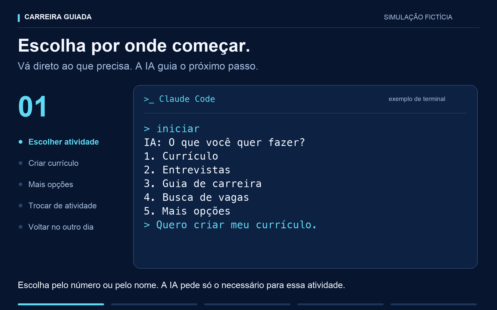

# Onde você quer procurar vagas?

O Carreira Guiada não traz portais pré-selecionados. Você pode informar os
endereços ou pedir ajuda para encontrar opções. A escolha aprovada fica no
seu perfil privado.

## Como enviar um link

1. Abra a página onde você quer procurar vagas, no seu navegador.
2. Clique na barra de endereço, no alto da janela, e copie o endereço.
3. Cole na conversa da ferramenta de IA em que você abriu o projeto.
   Pode enviar um de cada vez.
4. A IA confere o endereço e inclui os sites no resumo que você aprova.

Se precisar, diga "me ajude a copiar o link". A IA explica o próximo passo
com base na tela que conseguir observar. Você não precisa editar arquivo,
preencher uma configuração ou escolher um nome técnico para o site.

## Ainda não tenho os links

Diga "me ajude a encontrar sites de vagas". A IA usa seu cargo e mercado
pretendidos, sem enviar seus contatos ou currículo, e pesquisa opções públicas.
Antes de sugerir, confere identidade, domínio, origem oficial, evidência
independente e pedidos de dados. Mostra o que verificou, quando e o que ainda
não conseguiu confirmar. Você escolhe quais links quer usar e aprova a lista.

Popularidade e HTTPS sozinhos não comprovam segurança. A IA não recomenda
um site com identidade contraditória, pagamento suspeito ou risco não resolvido.
Uma análise favorável também não garante cada anúncio: vagas e recrutadores
são avaliados separadamente. Veja [pesquisa de empresas e vagas](EMPRESAS.md).

Se preferir, diga "deixe para depois". O currículo e as outras respostas podem
continuar. A IA não usa uma lista escondida nem os sites de outra pessoa.

## Se o endereço não for aceito

Use a página pública de busca ou de carreiras, começando com `https://`.
Não envie link de recuperação de senha, convite de acesso, sessão autenticada
ou endereço com código secreto. A IA explica o que precisa ajustar sem repetir
esses valores e sem pedir credenciais.

O controle local aceita endereços públicos, com parâmetros simples de pesquisa.
Alguns links legítimos precisam ser substituídos por uma página mais simples.
A verificação é sintática: não comprova que o site é confiável. A identidade
da empresa ainda precisa ser conferida.

## Como mudar de ideia

Diga "quero acrescentar este site", "não use mais este endereço" ou "quero
trocar os links da busca". A IA mostra a nova lista e pede sua aprovação.
As pesquisas seguintes usam a lista aprovada; o histórico anterior é preservado.

Se um anúncio levar a outro domínio, a IA verifica o destino e explica a
mudança. Nova fonte de pesquisa exige aprovação. Login e consentimentos no
destino continuam sendo decisões suas.

## Procedimento do agente

Os comandos e controles de pesquisa estão no
[protocolo técnico de fontes](INVESTIGACAO-AGENTE.md#fontes-escolhidas-pela-pessoa).
