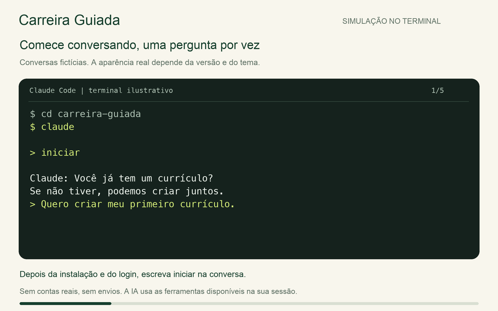
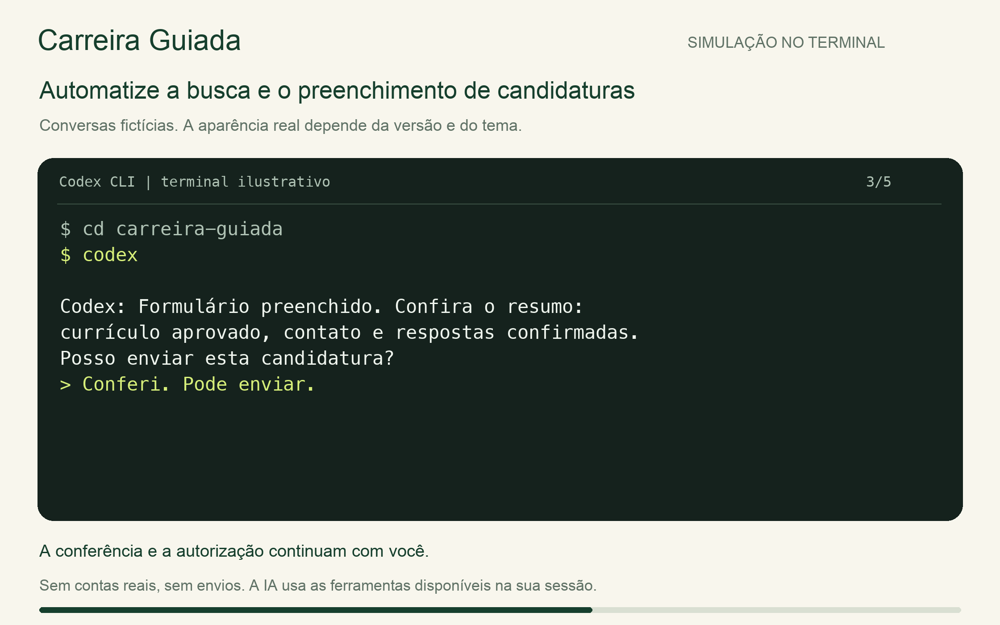
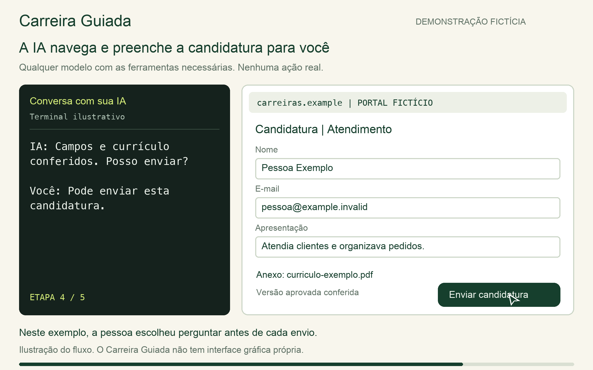

# Seu primeiro uso do Carreira Guiada

Você não precisa saber programar. O Carreira Guiada é uma pasta que sua IA lê para
conduzir a busca de emprego, uma etapa por vez. Este guia mostra o começo;
durante o uso, a própria IA explica o próximo passo.

## Primeira vez

1. Na página do projeto no GitHub, use **Code** e **Download ZIP** para baixar
   os arquivos. Abra o arquivo baixado para extrair a pasta. Ela pode se chamar
   `carreira-guiada-main`; esse nome também funciona.
2. Abra essa pasta no aplicativo de IA que você usa.
   A pasta aberta deve conter `README.md` e `AGENTS.md`.
   Só colar o link do GitHub em um chat comum não dá acesso aos arquivos locais.
3. No chat desse projeto, escreva **iniciar**.
4. A IA confere o ambiente e conduz uma pergunta por vez. Se faltar uma
   ferramenta, ela explica a instalação e pede a autorização necessária.

Se não encontrar como abrir a pasta, diga ao assistente qual aplicativo está
usando e que quer abrir a pasta do Carreira Guiada. Ele deve orientar com base nas opções
que conseguir observar, sem inventar nomes de botões.

O controle local usa macOS ou Linux. Windows nativo não é suportado; WSL ainda
não foi validado. A IA precisa conseguir ler arquivos e executar ferramentas.
O modelo pode ser de qualquer fornecedor. Se a ferramenta não ler o projeto
automaticamente, diga "leia o AGENTS.md desta pasta e me guie pelo início".
[Como escolher modelo e ferramenta](MODELOS.md).

## Usando pelo terminal

O terminal é a janela em que você digita comandos. Abaixo estão dois exemplos
de ferramentas compatíveis. Se escolher uma delas, siga o guia oficial:
[Claude Code](https://code.claude.com/docs/en/quickstart)
ou [Codex CLI](https://learn.chatgpt.com/docs/codex/cli).
As contas e permissões pertencem à ferramenta escolhida.
Em outro aplicativo, use o comando ou a opção de abrir pasta documentada por
ele. Não precisa instalar esses dois exemplos.

Abra o terminal na pasta que contém a pasta extraída do projeto. Entre na
pasta do projeto com o comando abaixo, usando o nome que ela realmente tem:

```sh
cd carreira-guiada
```

Use o nome que a pasta realmente tem, como `carreira-guiada-main` se baixou o
ZIP. Caso não saiba localizar a pasta, peça ajuda ao assistente que já usa
e informe o sistema operacional, sem compartilhar senhas.
Se você já abriu o terminal dentro da pasta do projeto, pule o comando `cd`.

Se estiver usando um desses exemplos, escolha **um** dos comandos:

```sh
claude
```

```sh
codex
```

Depois que a sessão abrir, escreva `iniciar` na conversa. Siga as orientações
de login e confiança da própria ferramenta. Não é necessário desativar as
proteções para usar este projeto.

As demonstrações abaixo representam conversas fictícias no terminal.
O Carreira Guiada não instala uma tela própria. Navegação e e-mail dependem
das integrações disponíveis na sessão; iniciar a CLI não conecta contas.



## A primeira conversa

Você pode dizer:

> iniciar. Não tenho currículo e é meu primeiro emprego.

Ou:

> iniciar. Anexei meu currículo e quero revisar antes de procurar vagas.

A IA recebe o arquivo ou monta um rascunho com você. Depois confirma nome,
e-mail, tipo de trabalho, salário e permissões. Não sabe um valor ou uma data?
Diga "não sei". Nada deve ser inventado.

Ela também pergunta **onde procurar**. Copie os links que você escolheu da
barra do navegador e cole no chat. Se ainda não tiver os links, diga "deixe
para depois". O currículo pode continuar; a pesquisa espera por essa escolha.
[Ajuda para informar os links](FONTES.md).

Você confere o resumo do perfil e aprova o currículo antes de qualquer envio.
Detalhes das perguntas: [Onboarding](ONBOARDING.md).

## Buscar por objetivo

Com o perfil e o currículo aprovados, você pode dizer:

> Quero que procure vagas compatíveis e envie as candidaturas autorizadas
> pelo meu perfil. Continue o trabalho por objetivo, sem me perguntar a cada
> lote. Me chame quando faltar uma decisão que só eu posso tomar.

A IA reaproveita suas permissões. Se você escolheu "pode fazer" para pesquisa,
preenchimento e envio, ela pode cuidar das próximas vagas sem aprovação por
candidatura. Se escolheu "pergunte antes", confirma aquela ação quando chegar
a hora. Responder e-mails, agendar e avaliações mantêm suas regras específicas.

Quando o aplicativo oferece modo objetivo (`goal`), a IA verifica como usá-lo
e mantém a campanha ativa conforme o recurso disponível. Você não precisa
saber comandos de controle. Não existe um comando universal de `goal`.
Sem esse recurso, ela trabalha durante a execução disponível e salva o ponto
de retomada; uma mensagem de status não comprova execução em segundo plano.

Uma campanha pode atravessar dias se a ferramenta sustentar a execução e as
conexões. Limites da conta, sessão expirada, CAPTCHA ou decisão pessoal ainda
podem exigir sua participação. A IA preserva a vaga afetada e continua as
demais. Diga `parar` a qualquer momento.

## Uma rodada de vagas

Quer apenas ver vagas agora? Diga isso. A IA prepara os filtros e os links;
o currículo pode ficar para depois. Só o preenchimento e o envio exigem a
versão aprovada.

1. Diga o que quer: "só me mostre as vagas" ou "procure vagas e me pergunte
   antes de enviar". Uma permissão de pesquisa não autoriza envio.
2. A IA busca nos endereços aprovados e explica quais vagas combinam com os
   filtros. Ela confere empresa e destino antes de fornecer seus dados.
3. Se algo importante estiver ausente, ela pergunta ou segue a regra que você
   já escolheu. Seu mínimo salarial não vira pretensão pública automaticamente.
4. Antes do envio, ela confere os dados e o currículo. A autorização segue
   as suas escolhas. A candidatura só é contada após confirmação do destino.
5. Você recebe o que foi confirmado, o que ficou em dúvida e a próxima ação.



Uma vaga bloqueada por login não impede cuidar de outra. Um envio com resultado
incerto exige conferência antes de tentar novamente.

## Exemplo de preenchimento no portal



O GIF do README mostra um cenário ilustrativo com perfil, fontes e currículo
já aprovados e uma ferramenta de navegador conectada:

1. A IA abre a vaga de atendimento da Empresa Exemplo e confere os filtros.
2. Abre o formulário e digita nome, contato e uma apresentação baseada nos
   fatos confirmados. Relê os campos após preencher.
3. Anexa `curriculo-exemplo.pdf`, a versão aprovada para aquela candidatura.
4. Mostra o resumo e pede autorização, pois a pessoa escolheu "pergunte antes
   de enviar". Com envio previamente autorizado, essa pergunta é dispensada.
5. Após a autorização, envia, confere a confirmação e registra o resultado.

O endereço `carreiras.example` é fictício. As telas são ilustrações de um
portal externo, não uma interface do Carreira Guiada. Nenhum site é acessado
e nenhum dado é enviado pela animação.

## Retornos por e-mail

Você decide se quer permitir leitura. Faça login somente na interface da conta
ou na conexão do aplicativo. Nunca informe senha ou código no chat.
O controle atual aceita Gmail e Outlook com uma ferramenta conectada.
Outros provedores podem ser usados como contato no currículo; o acompanhamento
automático dessas caixas ainda não é suportado.

A IA procura mensagens relacionadas às vagas acompanhadas e verifica a origem.
Para responder, mostra o destinatário e o texto para sua aprovação. Para
agendar, mostra a data completa, o horário e o fuso. Comparecer à entrevista
continua sendo uma ação sua.

A limpeza usa categorias que você autorizou, preserva mensagens com etapas
pendentes e move apenas mensagens individuais para a lixeira restaurável.
Ela não deve apagar e-mails definitivamente.

## Parar, voltar e corrigir

| Você diz | O que deve acontecer |
|---|---|
| "parar" | Novas ações param; o progresso é preservado. |
| "continuar" | A IA confere o estado salvo e o próximo passo autorizado. |
| "o que falta?" | Mostra pendências e o que depende de você. |
| "quero corrigir meu salário" | Atualiza a resposta e pede aprovação do perfil. |
| "não use mais este site" | Revê as fontes e pede aprovação da nova lista. |

O trabalho depende de execução ativa. A pasta guarda progresso, mas não
mantém uma IA rodando sozinha depois que a sessão termina.

## Quando algo trava

Descreva o que aconteceu. A IA deve explicar a próxima ação em linguagem
simples. Login, CAPTCHA e avaliações pessoais ficam com você. Restrições do
serviço devem ser respeitadas, sem tentativas de contorno.

Você pode continuar preparando o perfil mesmo quando uma integração estiver
indisponível. [Mais dúvidas](FAQ.md) · [Privacidade](PRIVACIDADE.md).
