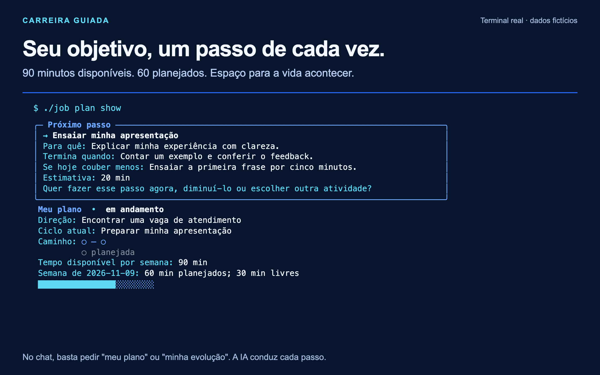

# Um plano que cabe na sua vida

Quando buscar emprego vira uma lista enorme, comece por uma ação possível.
Diga **"meu plano"**. A IA ajuda a escolher o próximo passo, organizar um ciclo
de algumas semanas e manter uma direção profissional. Você pode usar esse
recurso sem completar o cadastro de candidaturas.

> Quero uma vaga de atendimento, mas só tenho uma hora e meia por semana.
> Me ajude a decidir por onde começar.

## Do objetivo à próxima ação

A conversa aproveita o que você já contou no guia de carreira e nos treinos.
Você confere as sugestões antes de salvá-las. Se ainda não souber sua direção
ou disponibilidade, pode deixar em aberto e escolher apenas uma ação.

| Horizonte | Exemplo fictício |
|---|---|
| Agora | Ensaiar a apresentação e conferir uma sugestão de melhoria. |
| Próximas semanas | Preparar exemplos para as entrevistas de atendimento. |
| Direção profissional | Conseguir uma vaga de atendimento compatível com sua rotina. |

Cada ação tem uma finalidade, uma estimativa de tempo e um critério para saber
quando terminou. Pode levar ao currículo, entrevista, carreira, LinkedIn/GitHub,
análise de empresa, busca ou comparação de propostas. A IA abre a atividade
escolhida e mantém as permissões próprias dela.

O plano considera o tempo disponível. Se você tem 90 minutos na semana e
escolhe ações que somam 60, restam 30 minutos livres. Isso é uma estimativa de
agenda, não uma contagem de horas estudadas. Sem duração informada, a estimativa
fica incompleta. Atividades sem semana definida aparecem separadas.

Se a soma passar do tempo disponível, a IA oferece reduzir, adiar ou ajustar
uma ação. Você também pode combinar uma alternativa pequena:

> Se hoje eu estiver cansada, ensaio apenas a primeira frase por cinco minutos.

## Mudar de ideia faz parte

Você pode dizer "diminuir meu plano", "adiar esta ação", "pausar meu plano"
ou "quero mudar de direção". Uma mudança preserva as versões anteriores e as
ações já concluídas. A IA não transforma uma semana sem atividade em dívida.

Na volta, diga `iniciar` ou "continuar meu plano". Você vê o que ficou salvo e
escolhe continuar, ajustar ou trocar de atividade. Um plano pausado precisa de
um pedido de retomada. As candidaturas continuam com seu próprio estado.

O resumo identifica as ações como planejadas, em andamento, concluídas, adiadas
ou canceladas. As concluídas e adiadas continuam salvas, inclusive quando não
há um próximo passo ativo. Retomar o plano mantém os adiamentos; você escolhe
qual ação quer retomar. Se a lista for longa, peça "mostre todas as minhas ações".

### Exemplo: começar hoje e voltar amanhã

Lia, uma pessoa fictícia, quer preparar entrevistas de atendimento e tem uma
hora por semana. Ela combina duas ações de 20 minutos: ensaiar a apresentação
e preparar um exemplo de atendimento. Depois de ensaiar, diz:

> Fiz a apresentação e conferi a sugestão de melhoria. Pode marcar essa ação
> como concluída. Quero deixar o exemplo para depois e pausar meu plano.

No dia seguinte, "continuar meu plano" recupera a apresentação concluída e o
exemplo adiado. Lia pode dizer "quero retomar o exemplo, mas hoje só tenho dez
minutos". A IA combina o ajuste antes de salvar. Não precisa refazer o cadastro
nem explicar novamente o objetivo. Se quiser conferir sem retomar, basta
dizer "só quero ver meu plano".

Ao revisar um ciclo, a pergunta é curta: "O que ajudou e qual passo cabe agora?"
Você pode adiar a revisão. Datas de revisão são lembretes dentro da conversa;
não criam notificações nem mantêm a IA executando com o aplicativo fechado.

## Conclusão com contexto

A IA registra o que sustenta uma conclusão: seu relato identificado ou uma
referência de treino ou carreira. Uma anotação do plano não confirma uma
candidatura, não aprova um currículo e não autoriza envios. Se um envio ficou
incerto, o destino ainda precisa ser conferido.

Quando todas as ações combinadas terminarem, você pode revisar o ciclo,
escolher outro passo ou encerrar o plano. A IA não cria metas adicionais nem
arquiva o plano automaticamente. Marcar uma meta como concluída e registrar
uma prática em [Minha evolução](MINHA-EVOLUCAO.md) são escolhas separadas.

Quando um feedback usado no plano mudar, a IA avisa que a orientação precisa
ser revista. Ela não substitui silenciosamente o que você havia combinado.
O plano permanece privado na sua instalação, conforme [privacidade](PRIVACIDADE.md).

Você pode acompanhar suas práticas com [Minha evolução](MINHA-EVOLUCAO.md).
Esse acompanhamento é opcional; nenhuma atividade depende de pontos.
